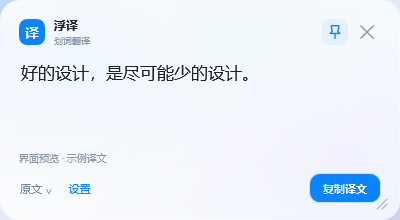
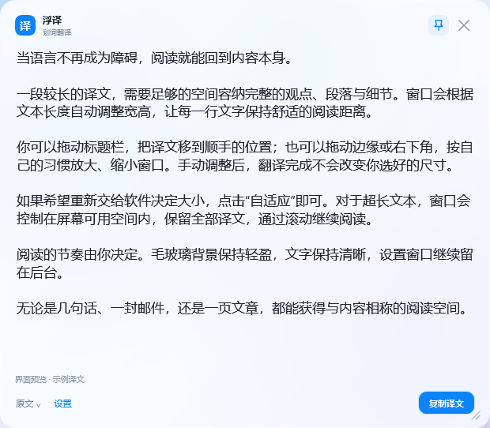

# 浮译 · Float Translate

Windows 桌面划词与截图翻译工具。选中文字或框选屏幕，译文出现在鼠标附近的毛玻璃小浮窗；设置窗口留在后台。

[下载 Windows 版](https://github.com/Akina2566/float-translate/releases/latest) · [完整使用说明](docs/usage.zh-CN.md) · [更新记录](CHANGELOG.md)



## 功能

- **划词翻译**：在支持复制的程序中选中文字，按全局快捷键读取选区并翻译。
- **截图翻译**：框选屏幕文字，使用你配置的视觉模型翻译；Esc 可取消框选。
- **自适应浮窗**：根据原文和译文长度调整宽高，长文本拥有更大的阅读区域；超出屏幕空间时滚动查看完整内容。
- **手动缩放**：拖动边缘、四角或右下角；译文返回后保留手动尺寸，点击“自适应”恢复自动调整。
- **自定义 API**：支持 OpenAI 兼容 Chat Completions 接口，可设置地址、密钥、文字模型、视觉模型及翻译偏好。
- **自定义快捷键**：直接按下组合键录入，保存时检测占用冲突。
- **毛玻璃外观**：明亮白色小浮窗、置顶、复制译文、原文查看、可调背景透明度。
- **托盘运行**：后台常驻；双击托盘图标打开设置，可选登录自启动。
- **本地历史**：最多 100 条记录，可关闭保存或清空。

## 开始使用

1. 从 [Releases](https://github.com/Akina2566/float-translate/releases/latest) 下载 ZIP，解压到固定目录。
2. 双击 `FloatTranslate.exe`，保留旁边的 `FloatTranslate.exe.config`。
3. 首次在设置中填写 API 地址、API Key 和文字模型 ID，点击“测试连接”，再“保存并应用”。
4. 如需截图翻译，配置支持图片输入的视觉模型；留空时使用文字模型。
5. 关闭设置窗口后，在任意支持复制的程序中使用快捷键。

| 操作 | 默认快捷键 |
| --- | --- |
| 选中文字翻译 | `Ctrl + Alt + T` |
| 框选截图翻译 | `Ctrl + Alt + S` |
| 取消框选 | `Esc` |
| 翻译页手动翻译 | `Ctrl + Enter` |

软件不附带 API 密钥或免费额度。API 调用和“测试连接”由你配置的服务处理并按其规则计费。截图与文字模型共用同一个 API 地址和密钥；截图模型必须支持 PNG Base64 `image_url` 输入。

## 长文本阅读

短译文浮窗约 400 × 220 个逻辑像素。长文本逐步增加至约 500、620、740 的宽度，自动高度最大约 820，并适应当前显示器的工作区域和缩放比例。浮窗始终保留完整译文，不截断长文本。



预览图中的文字为界面样例，柔化背景用于展示透明层次。运行时由 Windows 合成真实桌面背景的毛玻璃效果。

## 运行环境

- Windows 10/11 x64，.NET Framework 4.8。
- 原生 Acrylic 毛玻璃需要 Windows 11 22H2 / Build 22621 或更新版本；不支持时使用明亮浅色背景。
- 划词依赖目标程序的复制功能；特殊控件、受保护内容和高权限窗口可尝试截图，部分受保护内容也可能无法截图。
- 远程 API 必须使用 HTTPS；本机服务可使用 `http://localhost` 或 `http://127.0.0.1`。

## 从源码构建

```powershell
git clone https://github.com/Akina2566/float-translate.git
cd float-translate
powershell -NoProfile -ExecutionPolicy Bypass -File .\build.ps1
```

构建脚本使用系统 .NET Framework 的 C# 编译器及 WPF 程序集，生成根目录的 `FloatTranslate.exe`。不需要 .NET SDK、NuGet、Electron 或 Python。

```text
Source/                 C# 代码与 WPF 主题/界面
docs/                   使用说明和示例图片
app.ico                 应用与托盘图标
app.manifest            Windows 权限与 DPI 声明
FloatTranslate.exe.config
build.ps1               构建入口
```

## 验证

在正常 Windows 用户桌面环境中构建后运行：

```powershell
.\FloatTranslate.exe --self-test "$PWD\self-test-report.txt"
.\FloatTranslate.exe --ui-test "$PWD\ui-test-report.txt"
```

内置检查使用临时测试密钥和本机模拟 API，不调用真实第三方模型。覆盖请求格式、响应解析、错误提示、取消、DPAPI、历史记录、原生标题栏拖动与边缘缩放、自动窗口大小、超长译文滚动及手动尺寸保留。界面流程测试创建短暂的隐藏测试窗口，需运行在可使用桌面和系统托盘的 Windows 会话中。

实际模型的能力、额度、网络连接和所有第三方程序的划词/截图兼容性仍需在使用环境中验证。

## 数据与隐私

配置和记录存储于 `%LOCALAPPDATA%\FloatTranslate`。API Key 通过 Windows DPAPI 加密，只能由当前 Windows 用户解密；历史记录是本地原文与译文，最多 100 条，不保存截图。

截图仅在本次请求的内存中使用，文字和图片只发往配置的 API。软件没有遥测或上传历史记录的后台服务，启动时不会自动发送模型请求。

此仓库不包含个人 API Key、运行时配置或翻译历史；`.gitignore` 也排除了这些数据和构建产物。

## License

[MIT](LICENSE)
